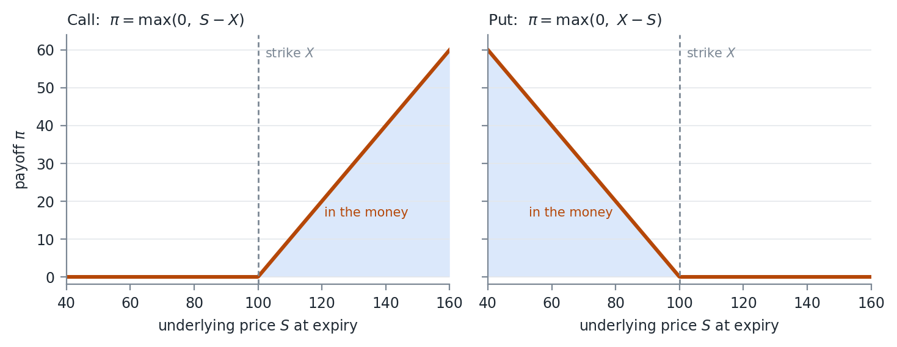
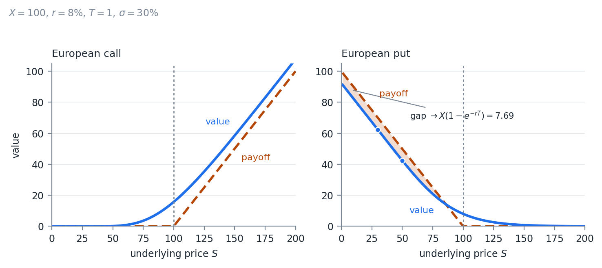

# Time Value of Money

## Where Week 05 Left Off

Weeks 04 and 05 measured risk on positions whose value moves in a straight line
with the underlying.

An option does not. Its payoff bends at the strike.

This week prices that payoff. Week 07 measures its risk.

::: {.notes}
Everything this week is a discounting problem wearing different clothes. Keep
coming back to the two questions: what is the payoff on average, and what is
that average worth today.
:::

## A Dollar Today

Modern finance is built on the time value of money. \$1 today is worth more
than a guaranteed \$1 at a future time.

Would you loan someone \$100 with a promise to pay \$100 back in 1 year?

At a minimum there is an opportunity cost to forgoing money until later. With
inflation, purchasing power drops over time, and there is a real cost as well.

## Two Questions at Once

An option is a payoff that arrives later and whose size is not known yet.

Everything that follows answers two questions:

1. What will the payoff be on average
2. What is that average worth today

## The Risk Free Rate

The rate at which money can be borrowed or lent without risk.

$$
P_{t+1} = P_t(1 + r_{rf})
$$

Usually the rate the government or banks borrow or lend at overnight, so it is
the 1 day risk free rate.

It is generally quoted as an annual rate. Compounding rules differ by market.

## Arbitrage

A return in excess of the risk free rate, without taking any risk.

Student A will buy 1 BTC from me for \$50,000. Student B will sell me 1 BTC for
\$30,000.

I buy from B and sell to A immediately and make \$20,000, a 67% return.

The risk free rate for zero time is always 0%, and $67\% > 0\%$.

## The Same Trade, a Year Out

Student A agrees to buy 1 BTC from me in 1 year for \$50,000. Student B sells me
1 BTC today for \$30,000. A 1 year government bond pays 1%.

Still a 67% return, now against a 1% risk free rate.

If there is no chance A fails to do the deal, which is credit risk, this is
still arbitrage.

The agreement with A is a forward.

## Free Money Does Not Last

When arbitrage exists, market actors are paid to take it.

The change in supply and demand moves prices toward a state where there is no
arbitrage.

> "All pricing problems in finance can be described as, 'find the no-arbitrage
> condition'"
>
> Some old finance professor

## Present Value

Present value is the current value of an asset, found by discounting its cash
flows.

$$
DiscountRate = RiskFreeRate + RiskPremium
$$

How to set the risk premium is the subject of another class. Know that it
exists, and that there can be several of them for several risks.

## A Certain Cash Flow

We will receive $\$X$ at time $t$ with certainty. No risk, so no premium, and
the discount rate is the risk free rate.

With $r$ continuously compounded and $t$ in years:

$$
PV = Xe^{-rt}
$$

## Why

Invest $PV$ in a government bond now and at time $t$ it is worth

$$
FV = PVe^{rt}
$$

If $FV \neq X$, one of the two is cheap and there is an arbitrage.

The present value is the price at which the arbitrage disappears.

## Many Cash Flows

A bond paying $X_i$ at times $i \in [1,2,\dots,t]$:

$$
PV = \sum_{i=1}^{t} X_i e^{-ri}
$$

Compounded discretely, $N$ times per year:

$$
PV = \sum_{i=1}^{t} \frac{X_i}{\left( 1 + \frac{r}{N} \right)^{N i}},
\qquad
\lim_{N \to \infty} \frac{1}{\left( 1 + \frac{r}{N} \right)^{N}} = e^{-r}
$$

## Continuous Compounding Is a Convenience

Nothing pays interest an infinite number of times per year.

It survives because it makes the algebra close.

That is why every option formula this week is written in $e^{-rT}$ rather than
a discrete compounding factor.

# Derivatives and Hedging

## What a Derivative Is

A contract whose value is derived from an underlying asset or reference: a
stock, a bond, a commodity, an interest rate, a currency, an index.

Forwards and futures, swaps, and options.

## Reshaping an Exposure

Derivatives change an exposure without buying or selling the underlying.

A jet fuel producer does not need to stockpile fuel to manage price risk.

A portfolio manager can change equity exposure in one trade with index futures
rather than touching every stock in the book.

## Hedging and Speculation

Hedging reduces the risk of an existing exposure. Take an offsetting position
that gains when the original loses.

Speculation is taking a position to profit from a forecast of direction,
volatility, or relative pricing.

Same instruments, both uses.

## The Contract Does Not Know the Difference

A put bought by someone who owns the shares is a hedge. The same put bought by
someone with no position is a speculation.

A company using currency forwards to stabilize future cash flows is hedging. A
trader using the same forwards to bet on the exchange rate is speculating.

Whether a position is a hedge depends on what else you hold.

## Risk Has a Price

The economic purpose of derivatives is to transfer risk and put a price on it.

Hedgers pay to reduce uncertainty, through the option premium or a less
favorable forward price.

Speculators accept the risk in exchange for that payment.

## Inherent Leverage

A large underlying exposure for a small upfront outlay, sometimes none.

Small moves in the underlying become large percentage moves on the position.

That is what makes derivatives efficient, and it is the same property that
makes them dangerous.

Selling options is the case to watch. The loss is not bounded by what was
posted.

# Options

## The Right, Not the Obligation

An option is the right, but not the obligation, to exchange at a later date at
a determined price.

Any contract where someone can decide later whether to transact is an option.

> "All options have value."
>
> Another old finance professor

## Where Options Appear

1. **Stock options.** Buy or sell a stock at a given price at a future date
2. **Loans with no prepayment penalty.** The borrower refinances when rates fall
3. **Callable bonds.** The issuer retires the debt on set dates when rates fall
4. **Puttable bonds.** The lender sells the bond back when rates rise
5. **Convertible bonds.** The holder converts to common stock at a set price
6. **Auto leases.** Buy the car at a set price at the end, or hand it back

## What Was Given Away

Items 2 through 6 are not traded as options.

They are often not priced as options by the party who wrote them.

The gap between what was sold and what was actually given away is where a great
deal of money has been made and lost.

## Terms {.smaller}

| Term | Meaning |
|:--|:--|
| Underlying | The security whose price sets the payoff |
| Strike | The price the underlying changes hands at |
| Call | The right to buy |
| Put | The right to sell |
| Exercise | Using the option |
| Maturity | The date the contract expires |
| Time to maturity | Time to that date, usually in years |

## An Example

An Apple option to buy 1 share at \$100 in 1 year.

The underlying is Apple stock, the strike is \$100, the time to maturity is 1
year, and it is a call.

Change "buy" to "sell" and it is a put.

## Exercise Styles

**European.** Exercise only at maturity. Most US index options

**American.** Exercise at any time. Most single name equity options

**Bermuda.** Exercise on set dates in between. Bermuda sits roughly halfway
between the Americas and Europe

**Asian.** The strike or the underlying price is set by an average, which lowers
volatility and resists manipulation. Energy and some commodities, usually cash
settled

## The Style Sets the Difficulty

European is the only one of the four with a closed form solution.

Every case in this course that needs a tree needs it because of the exercise
style, not because of anything about the underlying.

Week 07 takes up the American case.

## Settlement

**Physical.** The underlying changes hands at exercise. US stock options

**Financial, or cash.** The difference between strike and underlying is paid
instead. US index options

## Implied Volatility

An option's value depends on the range of outcomes at exercise, so there is
some distribution of prices behind it.

We cannot observe the market's expectation of that volatility.

We can observe option prices, and back out the volatility that the pricing
function needs to match them.

We come back to it at the end.

## Payoffs

The payoff $\pi$ is the money made at exercise. $S$ is the underlying price and
$X$ the strike.

$$
\text{Call:}\ \ \pi = \max(0,\ S - X) \qquad\qquad \text{Put:}\ \ \pi = \max(0,\ X - S)
$$

A call with $S > X$: buy at $X$, sell at $S$. With $S < X$, do nothing, since
the stock is cheaper in the market.

A put is the mirror. With $S < X$, buy at $S$ and sell at $X$.

## Call and Put at Expiry

{width=88%}

## The Kink

The kink at the strike is the whole difficulty of this week.

It is where the payoff stops being linear.

That is why Delta Normal VaR from Week 04 fails on a book of options, why the
second derivative gets a name of its own in Week 07, and why a tree or a
simulation is needed wherever there is no closed form.

## Moneyness

**At the money.** Strike and underlying are close together

**In the money.** Immediate exercise has a positive payoff

**Out of the money.** Immediate exercise pays 0

Moneyness is the degree to which an option is in or out of the money.

# Option Valuation

## The Integral

The value is the present value of the average payoff at exercise.

With $f(S)$ the PDF of the underlying price at exercise time $t$:

$$
Value = e^{-rt} \int_{0}^{\infty} \pi\, f(S)\, dS
$$

## Two Operations

The integral is an expected payoff under an assumed distribution.

The $e^{-rt}$ discounts that expectation to today.

Every method in this section does the same integral. They differ only in how
the distribution of $S$ is obtained.

## A Worked Example

Value a European call with:

- Underlying price 100, strike 100
- 125 days to maturity, 255 trading days in a year
- Risk free rate 5%
- Implied volatility 20%
- Prices lognormally distributed

## Volatility to Maturity

$$
dailyVol = \frac{0.2}{\sqrt{255}} = 1.252\%
\qquad
\sigma = dailyVol \cdot \sqrt{125} = 14\%
$$

## The Drift

The mean of a lognormal:

$$
Y \sim LN(\mu,\sigma) \Rightarrow E(Y) = e^{\mu + \frac{\sigma^2}{2}}
$$

We grow the asset at the risk free rate, which is part of the no arbitrage
condition. With $ttm = \frac{125}{255}$:

$$
\mu = \ln\left( P_0 \right) + ttm \cdot r - \frac{\sigma^2}{2}
$$

$$
\mu = \ln(100) + \frac{125}{255}(0.05) - 0.0098 = 4.6199
$$

## Why Subtract

Leave $\mu$ alone and the $\frac{\sigma^2}{2}$ in the lognormal mean goes with
it.

Then raising the assumed volatility raises the expected price, and we have
manufactured an arbitrage out of nothing.

Subtracting the same term inside $\mu$ holds the expected price at $P_0 e^{rT}$
for any $\sigma$ we choose.

## The Value

$$
Value = e^{-\frac{125}{255}(0.05)} \int_{0}^{\infty} \max(0,\ S - 100)\, f(S)\, dS \approx 6.8089
$$

$$
f(S) = \frac{1}{S\sqrt{2\pi\sigma^2}} e^{-\frac{\left( \ln(S) - \mu \right)^2}{2\sigma^2}}
$$

The lognormal density, with the $\mu$ and $\sigma$ just found. Solved
numerically.

For a European option there is a closed form.

## Black Scholes Merton

Black and Scholes (1973) set up a second order partial differential equation
that must hold for no arbitrage, through a replicating portfolio of continuous
delta hedging.

Merton published the same derivation shortly after.

Scholes and Merton received the Nobel Prize in Economics in 1997. Black had died
of cancer in 1995, and the Nobel committee does not care about dead people.

## Four Papers, One Equation

1. **Black Scholes 1973.** Non-dividend paying equities. Equals the integral we
   just did
2. **Merton 1973.** Equities paying a continuous dividend. $\mu$ includes the
   dividend accrual
3. **Black 1976.** Futures. Quoted in future value, so $\mu$ does not grow
4. **Garman and Kohlhagen 1983.** FX. The foreign risk free rate enters

## The Generalized Form

$S$ underlying, $X$ strike, $T$ time to maturity, $\sigma$ implied volatility,
$r$ risk free rate, $b$ cost of carry, $\Phi$ the normal CDF.

$$
d_1 = \frac{\ln\left( \frac{S}{X} \right) + \left( b + \frac{\sigma^2}{2} \right)T}{\sigma\sqrt{T}},
\qquad
d_2 = d_1 - \sigma\sqrt{T}
$$

$$
Call = Se^{(b-r)T}\Phi\left( d_1 \right) - Xe^{-rT}\Phi\left( d_2 \right)
$$

$$
Put = Xe^{-rT}\Phi\left( -d_2 \right) - Se^{(b-r)T}\Phi\left( -d_1 \right)
$$

## Cost of Carry

| Cost of carry | Model | Underlying |
|:--|:--|:--|
| $b = r$ | Black Scholes 1973 | Equities with no dividends |
| $b = r - q$ | Merton 1973 | Equities paying a continuous dividend rate $q$ |
| $b = 0$ | Black 1976 | Futures |
| $b = r - r_{ff}$ | Garman and Kohlhagen 1983 | FX, $r_{ff}$ the foreign risk free rate |

## Why One Formula

The four papers differ in what the underlying does to itself while you hold the
option.

That is entirely captured by $b$.

In the integral it is one change to the drift. The underlying grows at the cost
of carry:

$$
\mu = \ln\left( P_0 \right) + ttm \cdot b - \frac{\sigma^2}{2}
$$

## Monte Carlo

When the distribution of the final price is unknown, simulate.

1. Simulate prices through time for $N$ iterations
2. Evaluate the payoff function at the final time
3. Average the payoff across the simulations
4. Discount that average to the present

## Only Step 2 Is New

The four steps are the same integral, evaluated by sampling instead of by
quadrature.

Week 03 built the machinery for the draws. Week 05 let us draw from something
other than a normal.

The payoff function is the only new piece.

## Value Against Payoff: Calls

For a European call on a non-dividend paying stock, the value is always above
the payoff before maturity.

$$
Call\ Value_t > \pi_t \ \ \ \forall\ t > 0
$$

The premium over the payoff decays with time, theta decay, until the value
equals the payoff at maturity.

## Value Against Payoff: Puts

This does not hold for puts.

The put holder receives the strike $X$, but only at maturity, so the strike is
discounted.

As $S \to 0$ the European put goes to $Xe^{-rT} - S$ while the payoff is
$X - S$.

The put sits below its payoff by $X\left(1 - e^{-rT}\right)$, the interest on
the strike.

## Value and Payoff

{width=88%}

## The Numbers in the Right Panel

$X=100$, $r=8\%$, $T=1$, $\sigma=30\%$.

| $S$ | Put value | Payoff | Gap |
|--:|--:|--:|--:|
| 50 | 42.46 | 50.00 | 7.54 |
| 30 | 62.31 | 70.00 | 7.69 |

The gap converges to $X(1-e^{-rT}) = 7.69$.

That gap is what makes early exercise of an American put worth something. Next
week.

# Put Call Parity

## The Relationship

Higgins (1902) and Nelson (1904). A European put and call on the same
underlying, strike, and maturity:

$$
C + Xe^{-rT} = P + S
$$

A no arbitrage condition, assuming the underlying can be shorted, we can borrow
and lend at the risk free rate, and there are no transaction costs.

## Every Term Is a Trade

- $C$, buy the call
- $Xe^{-rT}$, lend the present value of the strike
- $P$, buy the put
- $S$, buy the underlying

Put the trades together and we can replicate a call, or a put, out of the
others.

## Replication

A replicating portfolio is a set of trades today that mirrors the payoff of
another portfolio.

Same payoffs in every state means the same value today.

Otherwise buy the cheap one, sell the dear one, and lock in the difference.

$$
C = P + S - Xe^{-rT}
$$

## Show It Holds {.smaller}

| Transaction | $t=0$ | $t=T$, $S_T > X$ | $t=T$, $S_T \leq X$ |
|:--|--:|--:|--:|
| Buy C | $-C$ | $S_T - X$ | $0$ |

: Buying the call {tbl-colwidths="[31,23,23,23]"}

| Transaction | $t=0$ | $t=T$, $S_T > X$ | $t=T$, $S_T \leq X$ |
|:--|--:|--:|--:|
| Buy P | $-P$ | $0$ | $X - S_T$ |
| Buy stock | $-S_0$ | $S_T$ | $S_T$ |
| Borrow PV of X | $Xe^{-rT}$ | $-X$ | $-X$ |
| **Total** | $Xe^{-rT} - P - S_0$ | $S_T - X$ | $0$ |

: The replicating portfolio {tbl-colwidths="[31,23,23,23]"}

## Read Straight Down

The two tables share their columns.

In both future states, buying the call pays the same as buying a put, buying
the stock, and taking out a loan.

If the two cost different amounts today, the arbitrage runs in whichever
direction is cheaper.

## On the Worked Example

The call from the valuation section was worth 6.81. The put on the same terms is
worth 4.39.

$$
\underbrace{6.81}_{C} + \underbrace{100e^{-0.05 \cdot 125/255}}_{97.58} = 104.39 = \underbrace{4.39}_{P} + \underbrace{100}_{S}
$$

Price one and parity hands you the other.

## The Cheapest Data Check

Take a call and a put on the same underlying, strike, and maturity, and compute
both sides.

If they disagree by more than the bid-ask spread, one price is stale or one of
the contract terms in your database is wrong.

My opinion: run it on every option data set before anything else touches it.

# Binomial Trees

## Cox, Ross, and Rubinstein

Published in 1979, and a way to value options with path dependencies.

A recombining tree that approximates geometric Brownian motion in discrete
steps.

Take it to the limit of infinitely many small steps and it converges to Brownian
motion.

Reading: Hull, *Options, Futures, and Other Derivatives*, 11th edition, Chapter
13.

## One Step

A European call, strike \$100, share price \$100, risk free rate 5%, 1 year to
maturity.

Say the stock either gains 10% or loses 10%. The 10% is arbitrary for now.

The call is worth either \$10 or \$0 at expiration.

## The Smallest Tree

{width=60%}

## The Intuitive Answer

A probability weighted average of the final states, discounted:

$$
C_0 = e^{-0.05}\left( p \cdot 10 + (1-p) \cdot 0 \right)
$$

Which leaves $p$.

## Risk Neutral Probability

The probability of the up move in the risk neutral world, not the real one.

$$
p = \frac{e^{b \Delta t} - d}{u - d}, \qquad (1-p) = \frac{u - e^{b \Delta t}}{u - d}
$$

$u$ and $d$ are the price multipliers on the up and down moves.

The cost of carry $b$ in place of $r$ keeps it consistent with the generalized
Black Scholes Merton. Hull walks through the proof.

## No Real Probabilities Needed

We never need the real probability of an up move.

The risk neutral probability with risk free discounting gives the same value as
the real probability with a discount rate that carries the right risk premium.

The second requires the premium. The first does not.

## Back to the Example

One step, so $\Delta t = T = 1$:

$$
p = \frac{e^{0.05} - 0.9}{1.1 - 0.9} = \frac{0.1513}{0.2} = 0.7564
$$

$$
C_0 = e^{-0.05}\left( 0.7564 \cdot 10 + 0.2436 \cdot 0 \right) \approx 7.20
$$

## Adding Volatility

The 10% was arbitrary. Volatility sets $u$ and $d$:

$$
u = e^{\sigma\sqrt{\Delta t}}, \qquad d = e^{-\sigma\sqrt{\Delta t}}, \qquad \Delta t = \frac{T}{N}
$$

$N$ is the number of steps and $T$ the time to maturity in years.

## Why the Tree Recombines

$ud = 1$, so up then down returns to exactly the starting price.

An $N$ step tree has $N+1$ terminal nodes instead of $2^N$.

At $N = 50$ that is 51 nodes against a number with 16 digits in it.

## Two Steps

$T = 1$, $N = 2$, $S = X = 100$, $r = b = 0.05$, $\sigma = 0.1$.

$\sigma$ is annual here. The first example started at 20% annual and became 14%
to maturity, so the two are not directly comparable.

$$
u = e^{0.1\sqrt{0.5}} = 1.073271, \qquad d = e^{-0.1\sqrt{0.5}} = 0.931731
$$

$$
p = \frac{e^{0.05 \cdot 0.5} - 0.931731}{1.073271 - 0.931731} = 0.6612
$$

## The Recombining Tree

{width=80%}

## Three States

| State | $S_T$ | $p_T$ | $C_T$ |
|:--|--:|--:|--:|
| Up Up | $Su^2 = 115.19$ | $p^2 = 0.4372$ | 15.19 |
| Up Down | $Sud = 100$ | $2p(1-p) = 0.4480$ | 0 |
| Down Down | $Sd^2 = 86.81$ | $(1-p)^2 = 0.1148$ | 0 |

The middle state is reached by two paths, up then down or down then up, hence
the 2.

$$
C \approx e^{-0.05}\left( 15.19 \cdot 0.4372 \right) = 6.32
$$

## Use Enough Steps

Black Scholes Merton gives \$6.80 exactly. Two steps is off by \$0.49.

| Steps $N$ | Tree value |
|--:|--:|
| 2 | 6.32 |
| 10 | 6.70 |
| 50 | 6.78 |
| 200 | 6.80 |
| 1000 | 6.8039 |
| Closed form | 6.8050 |

## The General N Step Tree

For each terminal node $i \in 0 \dots N$:

$$
S_{T,i} = S u^{i} d^{N-i}, \qquad
p_{T,i} = p^{i}(1-p)^{N-i}
$$

$$
nPaths = \frac{N!}{i!(N-i)!}
$$

$nPaths$ is the number of paths that arrive at node $i$.

$$
Value = e^{-rT}\sum_{i=0}^{N} \left( \frac{N!}{i!(N-i)!} \right) p^{i}(1-p)^{N-i}\, \pi\left( S u^{i} d^{N-i} \right)
$$

## The Same Model

That sum is a binomial distribution over terminal prices.

As $N$ grows the Central Limit Theorem takes it to the lognormal from the
valuation section.

The tree and the closed form are the same model at different resolutions.

## Why Bother With the Tree

The formula sums over terminal nodes only, so it prices the European case, which
the closed form already did.

Work backwards through the tree node by node instead, taking the larger of the
continuation value and the exercise payoff at each node, and it prices the
American case.

That is Week 07.

# Implied Volatility

## Solving Backwards

So far volatility has been an input. The market's volatility is not directly
observable.

Solve for it from the valuation formula and the observed price.

Value is monotone in $\sigma$, since more volatility is always more option
value. The inverse exists and is unique, and any root finder will find it.

## An Example

An observed price of \$6. 125 days to maturity, 255 days in a year, risk free
rate 5%, strike \$100, stock \$100.

Root find on the generalized Black Scholes Merton.

The implied volatility is approximately 17%.

## A Sensitive Read

The same option at 20% was worth \$6.81.

\$0.81 of price moved the implied volatility by 3 points, about \$0.27 per
point.

Option prices are a sensitive read on the market's volatility expectation and a
noisy one on anything else.

That is why traders quote options in volatility, not in dollars.
