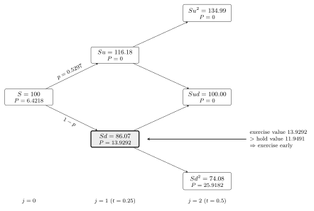
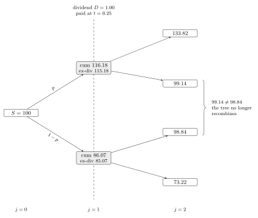
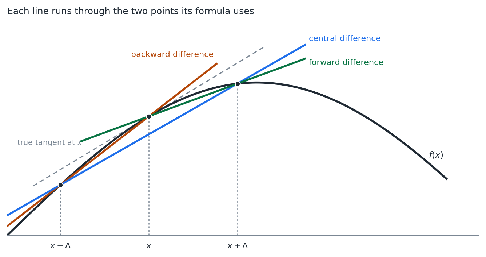
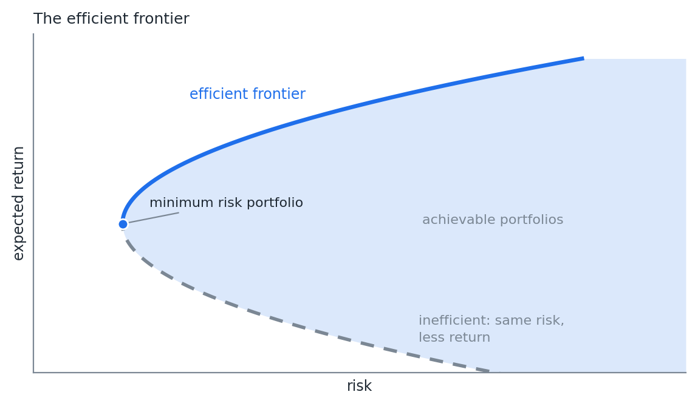
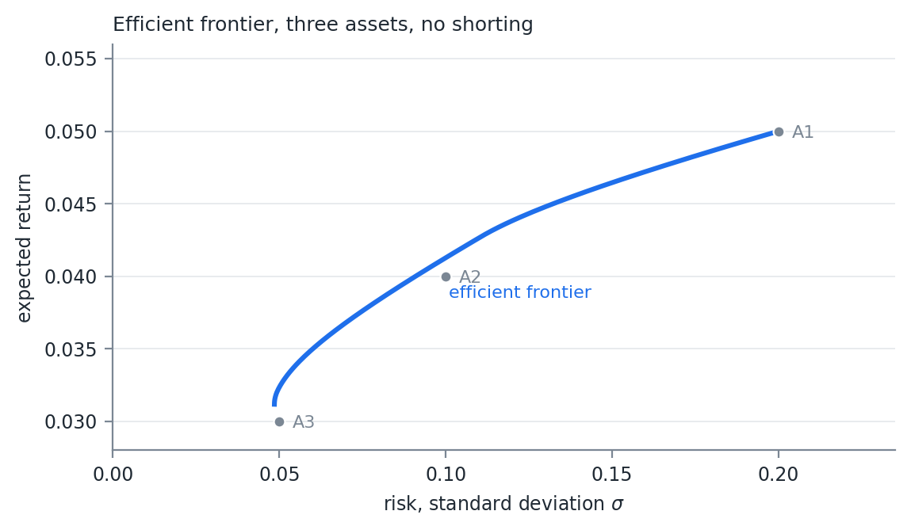
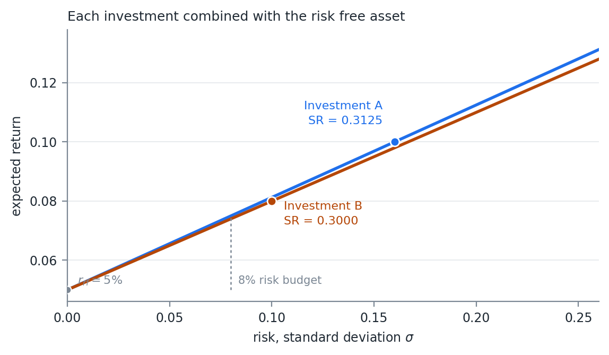
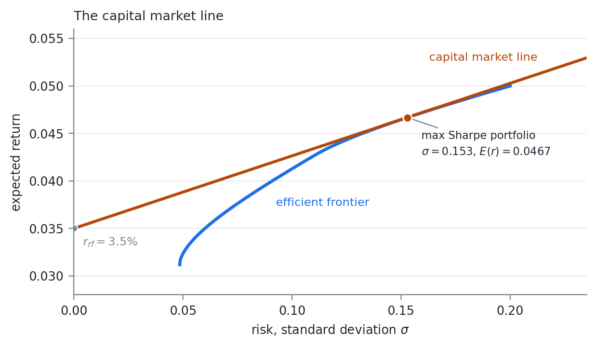

# American Options

## Where Week 06 Left Off

Week 06 priced a European option three ways: the integral, the closed form, and
the tree.

The tree was the only one that could be walked backwards. That is what the
American case needs.

The second half of the week leaves options behind and builds portfolios.

::: {.notes}
Two halves that look unrelated. The first is still a no arbitrage argument, now
with a decision at every node. The second is the quadratic form from Week 02
traded against expected return. Both end in a picture with a boundary on it.
:::

## The Right to Exercise Early

An American option can be exercised at any time up to maturity.

That is more choice than the European holder has, and all options have value:

$$
Value_{American} \geq Value_{European}
$$

The question is when the extra choice is worth anything.

## Calls on Non-Dividend Payers

Exercising early gives up whatever option value remains and takes the payoff
instead.

For a call on a non-dividend paying stock, Week 06 showed the European value is
always above the payoff:

$$
Call\ Value_{American,t} \geq Call\ Value_{European,t} > \pi_t \ \ \ \forall\ t > 0
$$

Selling the option always beats exercising it.

## Worth Exactly the European

The early exercise right on that call is never used, so it is worth nothing.

An American call on a non-dividend paying stock is priced as the European call.

## Unless There Is a Cash Flow

If the underlying pays something, exercising may be worth it to own the stock
and collect the payment.

When the cash flow plus the payoff exceeds the value of the option, exercise
early.

That is the discrete dividend section.

## Puts Are Different

Week 06 ended with a deep in the money European put sitting below its payoff.

The strike arrives only at maturity, so it is discounted. The gap is the
interest on the strike.

## The Arbitrage Floor

An American put cannot trade there:

$$
Put\ Value_{American,t} \geq \pi_t \ \ \ \forall\ t
$$

If it did, buy the put and exercise it immediately. Pay less than $X - S$,
receive exactly $X - S$, with no risk and no waiting.

Anyone can do that, so the price never gets there.

## The Early Exercise Premium

The European put is free to sink below its payoff, and does.

The American put is held up at the payoff by arbitrage.

The difference between the two is what the early exercise right is worth.

Early exercise of an American put can be optimal with no dividend at all.

## The Free Boundary

The exercise decision is a critical stock price $S^*$.

Below $S^*$, exercise. Above it, hold.

$X=100$, $r=8\%$, $\sigma=30\%$, with $0.25$ years remaining: $S^*$ is a little
under 82.

## Why There Is No Closed Form

The boundary is not known in advance. It comes out of the same backward
induction that produces the price.

It moves as the time remaining shrinks.

Those two together are why the European put has a formula and the American put
does not.

## Valuing with a Tree

Modify the European tree from Week 06:

1. Construct the tree as before
2. Calculate the underlying price at every node, not just the final ones
3. At the maturity nodes, value the option with the payoff function
4. Work backwards, taking the better of exercising now and holding

American and Bermuda options are both typically valued this way.

## Backward Induction

At node $i$ of step $j$:

$$
P_{i,j} = \max\left( \pi\left( S u^{i} d^{(j-i)} \right),\ e^{-r\Delta t}\left[ p P_{i+1,j+1} + (1-p) P_{i,j+1} \right] \right)
$$

The first term is exercising. The second is the discounted, risk neutral value
of holding one more step.

## One Change From Week 06

The European formula summed over terminal nodes only.

The change is the $\max$.

A sum can be evaluated. A sequence of $\max$ operations has to be walked.

That is the whole reason the European case has a closed form and this one does
not.

## Two Step Example

American put, $N=2$, $T=0.5$, $S=100$, $X=100$, $r=b=0.08$, $\sigma=0.3$.

$$
u = e^{0.3\sqrt{0.25}} = 1.1618, \qquad d = e^{-0.3\sqrt{0.25}} = 0.8607, \qquad p = 0.5297
$$

## The Tree

{width=75%}

## Walking Back

At maturity the value is the payoff. Only the bottom node, $S = 74.08$, is worth
anything: $25.9182$.

At $(j=1, i=0)$, $S = 86.07$:

$$
\pi = 13.9292, \qquad e^{-0.08 \cdot 0.25}\left( 0.4703 \cdot 25.9182 \right) = 11.9491
$$

Exercise is worth more. The node takes $13.9292$.

At the root:

$$
e^{-0.08 \cdot 0.25}\left( 0.4703 \cdot 13.9292 \right) = 6.4218
$$

## One Node Changed the Answer

The early exercise happened at exactly one place in the tree.

It changed the root value because the larger number propagated backwards.

Everything else in the tree is the European calculation.

## A Word of Caution

The exercised node sits at $S = 86.07$, above the true boundary.

A converged model would not exercise there.

The coarse tree gets the right qualitative answer for the wrong reason.

## Use Enough Steps

| | 2 step tree | Converged |
|:--|--:|--:|
| European put | 5.5088 | 6.4670 |
| American put | 6.4218 | 6.8662 |
| Early exercise premium | 0.91 | 0.40 |

: {tbl-colwidths="[40,30,30]"}

The 2 step tree more than doubles the premium.

# American Options with Discrete Dividends

## Continuous Dividends Work for Indexes

An index is a basket of stocks paying dividends at different times.

They accrue to the index slowly, and the continuous dividend rate from Week 06,
$b = r - q$, describes that well.

## Single Stocks Pay Dollars

A single stock pays a set amount on a set date, not a rate.

When the dividend is paid, the share price drops by the amount of the dividend.

That is a discontinuity in the price path.

## Why the Tree Stops Recombining

Week 06's tree recombined because $ud = 1$. Up then down returned exactly to the
starting price.

Subtracting a fixed dollar amount at one date breaks that.

The same dollar is a different percentage at every node.

## An Example

American call, $N=2$, $T=0.5$, $S=100$, $X=100$, $r=b=0.08$, $\sigma=0.3$.

A dividend of \$1.00 at $t=0.25$.

$$
u = 1.1618, \qquad d = 0.8607, \qquad p = 0.5297
$$

Same parameters as the put, so the tree before the dividend is the same tree.

## The Non-Recombining Tree

{width=62%}

## Each Dividend Spawns Trees

A dividend paid at $j = n$ creates $n+1$ new trees, one from each node at that
step.

Each new tree starts from the node's price less the dividend.

## Exercise at the Dividend Date

A call exercised at $j = n$ gets the stock and the dividend with it.

A put exercised at $j = n$ forgoes the price drop the dividend would have
brought.

Either way the exercise payoff is $\pi\left( S_n + D_n \right)$, the payoff as
if the dividend had not happened.

## What It Costs

After the dividend date the node count grows like $2^N$ again.

A tree with several dividends and a realistic number of steps becomes expensive
quickly.

## When Early Exercise Is Optimal

In practice, only calls are exercised early to receive the dividend.

Hull, Chapter 15, shows exercise is optimal when

$$
D_n > X\left( 1 - e^{-r\left( T - t_n \right)} \right)
$$

$t_n$ is the time dividend $D_n$ is paid.

## Interest on the Strike

The right hand side is the interest earned on the strike between the dividend
date and maturity.

Exercising early hands over the strike sooner.

The dividend has to be worth more than the interest given up.

## Apply It to the Example

$D_n = 1.00$, $X = 100$, $r = 8\%$, $T - t_n = 0.25$:

$$
X\left( 1 - e^{-0.08 \cdot 0.25} \right) = 1.98
$$

$1.00 < 1.98$. The dividend is too small to justify early exercise.

The example shows what a dividend does to the shape of the tree. Raise it above
\$1.98 and the call is exercised at $t_n$.

## Implementing It

An exercise in recursion, and it handles any number of dividends.

1. No dividends during the life of the option: use the recombining tree
2. Build the nodes up to the first dividend. At each node:
    a. **No exercise.** Call the tree recursively with the price less the
       dividend and the remaining dividends
    b. **Exercise.** The payoff on the price before the dividend
3. Work backwards to the starting node

## The Most Generic Method

There are many ways to handle discrete cash flows.

A tree that is allowed to stop recombining is the most generic. The same
structure applies to any problem with a fixed cash flow on a fixed date.

# The Greeks

## Sensitivities

The Greeks are the partial derivatives of the pricing function with respect to
its inputs.

They approximate the change in option value for a change in an input.

The underlying price and the implied volatility move, and that movement is the
risk in holding the option. Knowing the approximate change is what makes hedging
possible.

## Delta Is Week 04's $\delta$

Delta Normal VaR needed the first derivative of every position with respect to
every underlying price.

For an option, that derivative is delta.

The gradient from Week 04 was waiting for this.

## The Main Greeks {.smaller}

| Greek | Definition | Call | Put |
|:--|:--|:--|:--|
| Delta, $\Delta$ | $\frac{\partial P}{\partial S}$ | $e^{(b-r)T}\Phi(d_1)$ | $e^{(b-r)T}\left( \Phi(d_1) - 1 \right)$ |
| Gamma, $\Gamma$ | $\frac{\partial^2 P}{\partial S^2}$ | $\frac{f(d_1) e^{(b-r)T}}{S\sigma\sqrt{T}}$ | same as call |
| Vega | $\frac{\partial P}{\partial \sigma}$ | $S e^{(b-r)T} f(d_1)\sqrt{T}$ | same as call |
| Rho, $\rho$ | $\frac{\partial P}{\partial r}$ | $T X e^{-rT}\Phi(d_2)$ | $-T X e^{-rT}\Phi(-d_2)$ |
| Carry Rho | $\frac{\partial P}{\partial b}$ | $T S e^{(b-r)T}\Phi(d_1)$ | $-T S e^{(b-r)T}\Phi(-d_1)$ |

: {tbl-colwidths="[14,14,32,40]"}

From the generalized BSM. $f$ is the normal PDF and $\Phi$ the normal CDF. Gamma
is also called convexity. Rho is shown for Black Scholes, where $r = b$.

## Theta

The derivative with respect to time to maturity, $-\frac{\partial P}{\partial T}$.

Negative, but often quoted as a positive number. Also called theta decay.

$$
\begin{aligned}
\Theta_{call} &= -\frac{S e^{(b-r)T} f(d_1) \sigma}{2\sqrt{T}} - (b-r) S e^{(b-r)T}\Phi(d_1) \\
&\qquad - r X e^{-rT}\Phi(d_2) \\[10pt]
\Theta_{put} &= -\frac{S e^{(b-r)T} f(d_1) \sigma}{2\sqrt{T}} + (b-r) S e^{(b-r)T}\Phi(-d_1) \\
&\qquad + r X e^{-rT}\Phi(-d_2)
\end{aligned}
$$

## Gamma and Vega Match

Gamma and vega are identical for a call and a put at the same strike.

Put call parity forces it. The difference between the two is

$$
C - P = S - Xe^{-rT}
$$

Linear in $S$, so no second derivative. No $\sigma$ in it at all, so no vega.

## One Evaluation

Every formula carries $f(d_1)$ or $\Phi(d_1)$.

A single evaluation of the pricing function produces all of them.

## The Kink Gets a Name

Week 06 said the kink at the strike is where the payoff stops being linear.

Gamma is that curvature, measured.

Delta Normal VaR keeps the first derivative and throws gamma away. On a book of
options, that is the term that matters.

## Hedging Example

A market maker sells 100 calls that expire in 15 trading days, for \$2.50 each.

Stock at \$100.50, strike \$100, risk free rate 25bp, no dividend.

Priced with the GBSM.

1. What is the 1 day VaR and ES of the position, using a simulated normal?
2. Hedge by buying stock equal to the negative of the position's delta. What are
   the new VaR and ES?

## What the Hedge Leaves Behind

The hedge removes the first order exposure and leaves the second order exposure.

A short call is short gamma. The delta hedged book loses on a large move in
either direction.

Its VaR does not go to zero, however precisely the delta is matched.

Compare the two answers. Do not just report the second one.

## Numerical Derivatives

Not every valuation method has closed form derivatives.

An American option priced on a tree is the obvious case. There is no formula to
differentiate.

The simplest numerical method is a finite difference. Automatic differentiation
may be available, and faster or more accurate.

## Central Difference

$$
f'(x) \approx \frac{f(x+\Delta) - f(x-\Delta)}{2\Delta}
$$

Close enough for a small enough $\Delta$, assuming a smooth surface.

Two evaluations of the function. For some valuation methods, that is a real
computing cost.

## Forward Difference

$$
f'(x) \approx \frac{f(x+\Delta) - f(x)}{\Delta}
$$

$f(x)$ is the current value, already computed. One more evaluation.

Cheaper, and less accurate. A backward difference is the same trade.

## Three Secants

{width=80%}

## Why the Central Difference Wins

The forward and backward secants both sit visibly off the tangent.

They miss in opposite directions.

The central difference averages the two, and the leading error term cancels.

Worth the extra evaluation.

## Gamma Numerically

The first derivative of the first derivative:

$$
\begin{aligned}
f''(x) &\approx \frac{\frac{f(x+\Delta) - f(x)}{\Delta} - \frac{f(x) - f(x-\Delta)}{\Delta}}{\Delta} \\[10pt]
&= \frac{f(x+\Delta) + f(x-\Delta) - 2f(x)}{\Delta^2}
\end{aligned}
$$

## Choosing $\Delta$

Too large and the approximation error dominates.

Too small and the numerator subtracts two nearly equal floating point numbers,
then divides by something small.

The second derivative divides by $\Delta^2$. It is far more sensitive to the
choice than the first.

# Portfolio Construction

## Risk Against Return

Portfolio construction balances expected return against expected risk.

Higher expected returns generally require taking higher risks.

## Every Mix Is a Point

Every combination of the available assets gives a pair, an expected return and
a risk.

Plot all of them and they fill a region.

## The Efficient Frontier

{width=70%}

## The Left Edge

The efficient frontier is the left edge of the region, above the minimum risk
point.

The maximum return achievable for a given level of risk.

Equivalently, and this matters shortly, the minimum risk for a given level of
return.

## Nothing Below It

For any portfolio inside the region there is one directly above it on the
frontier, with the same risk and more return.

The dashed lower branch is the extreme case. Same risk as the solid branch, less
return.

The minimum risk portfolio is where the two branches meet.

## The Markowitz Problem

Harry Markowitz, Nobel Prize in Economics, 1990.

Assume multivariate normality. Risk is portfolio variance.

$$
\max\ U(w) = w\mu^T - \frac{1}{2}\lambda\, w\Sigma w^T
\qquad
s.t.\ \sum_{1}^{n} w_i = 1
$$

$w$ the weights, $\mu$ the expected returns, $\Sigma$ the covariance, $\lambda$
risk aversion.

## One Quadratic Form

$w\Sigma w^T$ is fact 7 from Week 02 again.

The whole optimization is that one quadratic form, traded against a linear term.

Solve it for different $\lambda$ and each solution is a point on the frontier.

## Nobody Knows Their $\lambda$

Nobody has a quadratic utility function.

Asking someone for their $\lambda$ is nonsensical.

## The Minimum Variance Form

Invert the graph. The maximum return for a given risk is the minimum risk for a
given return.

$$
\min\ \sigma^2 = w\Sigma w^T
\qquad
s.t.\ \sum_{1}^{n} w_i = 1, \quad w\mu^T = R
$$

Still a quadratic problem, and easily solved.

## Bounds on the Weights

Often we disallow shorting, meaning negative weights, or limit how much can be
short.

Those bounds are additional linear constraints. The problem stays a quadratic
program.

## Same Curve, Different Dial

Both forms trace the same frontier.

The first sweeps it by varying $\lambda$. The second by varying $R$.

Implement the second. $R$ is a number an investor can actually state.

## A Three Asset Example

No negative weights.

| | A1 | A2 | A3 |
|:--|--:|--:|--:|
| A1 | 1 | 0.5 | 0 |
| A2 | 0.5 | 1 | 0.5 |
| A3 | 0 | 0.5 | 1 |
| **Std dev** | 0.20 | 0.10 | 0.05 |
| **$E(r)$** | 0.05 | 0.04 | 0.03 |

: Correlations, standard deviations, and expected returns {tbl-colwidths="[28,24,24,24]"}

## Tracing It

Solve the minimum variance problem once for each $R$ between the lowest and
highest achievable return.

Each solve returns a weight vector. Each weight vector is one point on the curve.

## The Frontier

{width=70%}

## Where the Assets Sit

A1 is on the frontier. It is the only way to reach the highest return.

A3 is on it too, close to the lowest risk available.

A2 sits inside. A mix of A1 and A3 beats holding A2 alone.

That is diversification, and it comes entirely from the zero correlation between
A1 and A3.

# The Sharpe Ratio and the Capital Market Line

## Sharpe

William Sharpe and others, mid 1960s. The papers that led to CAPM.

Sharpe shared the 1990 Nobel Prize with Markowitz and Merton Miller.

$$
SR = \frac{E\left( r_p \right) - r_{rf}}{\sigma_p}
$$

Expected return in excess of the risk free rate, in units of risk.

## Two Investments

Choose A or B, not both. Borrow and lend at the risk free rate of 5%.

| | $E(r)$ | $\sigma$ | $SR$ |
|:--|--:|--:|--:|
| A | 10% | 16% | 0.3125 |
| B | 8% | 10% | 0.3000 |

The investor wants 8% risk.

## Hit the Risk Budget

**A.** 50% in A, 50% in the risk free asset:

$$
E(r) = 7.5\%, \qquad Risk = \sqrt{0.5^2 \cdot 0.16^2} = 8\%, \qquad SR = 0.3125
$$

**B.** 80% in B, 20% in the risk free asset:

$$
E(r) = 7.4\%, \qquad Risk = \sqrt{0.8^2 \cdot 0.10^2} = 8\%, \qquad SR = 0.3000
$$

## Choose A

Same risk, more return.

Each mix kept the Sharpe Ratio of the investment it was built from.

## More Risk Than A

Borrow 50% at the risk free rate and buy more A:

$$
E(r) = 150\% \cdot 10\% + (-50\%) \cdot 5\% = 12.5\%
$$

$$
Risk = \sqrt{1.5^2 \cdot 0.16^2} = 24\%, \qquad SR = \frac{12.5 - 5}{24} = 0.3125
$$

The Sharpe Ratio survives leverage too.

## Each Investment With Cash

{width=70%}

## Two Points Fix the Line

The risk free asset, at $\sigma = 0$ and $\mu = r_{rf}$. The line starts there.

The investment itself, at $\left( \sigma_p, E(r_p) \right)$.

$$
\text{slope} = \frac{E\left( r_p \right) - r_{rf}}{\sigma_p - 0} = SR
$$

## The Sharpe Ratio Is the Slope

Not an analogy. The definition of the ratio and the rise over run of the line
are the same expression.

Every mix of the investment and cash lands on the line, so the ratio holds at
every level of risk.

A steeper line through the same intercept is above a shallower one everywhere to
the right. A beats B at every risk budget, not just 8%.

## Why the Locus Is a Line

Two of the risk measure properties from Week 05.

**Positive homogeneity.** $q(\lambda X) = \lambda\, q(X)$. Holding a fraction
$w$ of the investment scales its risk by exactly $w$.

**Translation.** Adding a certain amount does not change dispersion. The cash
leg contributes nothing to $\sigma$.

## Both Coordinates Are Linear

$w$ in the investment and $1-w$ in cash:

$$
\sigma\left( w\, r_p + (1-w) r_{rf} \right) = w\, \sigma_p
$$

$$
E\left( w\, r_p + (1-w) r_{rf} \right) = r_{rf} + w\left( E(r_p) - r_{rf} \right)
$$

Both linear in the same $w$. That is a straight line, and the ratio of the two
slopes is the Sharpe Ratio.

## A Caveat on Terms

Standard deviation is subadditive, positively homogeneous, and satisfies the
translation property.

It is not monotone. A portfolio that loses more in every state can still have
the lower standard deviation.

So it is a deviation measure, not a coherent risk measure in Artzner's sense.
The two properties used here are ones it has.

## Variance Bends the Line

Variance is not positively homogeneous:

$$
\operatorname{var}(wX) = w^2 \operatorname{var}(X)
$$

Plot the same picture against variance and every one of these lines becomes a
curve.

That is why the axis is $\sigma$.

## The Steepest Line

If the slope is what we want, and we are choosing among every portfolio on an
efficient frontier rather than between two investments:

Which point on the frontier gives the steepest line out of $r_{rf}$?

## The Capital Market Line

{width=70%}

## Tangency

The capital market line, CML, is tangent to the efficient frontier at the
maximum Sharpe Ratio portfolio.

Also called the super efficient portfolio, or the market portfolio.

Mixing it with cash gives a return at least as high as the frontier at every
level of risk.

## On the Three Assets

At a 3.5% risk free rate:

| | Value |
|:--|--:|
| Weights | $\tfrac{2}{3}$ A1, $\tfrac{1}{3}$ A2, 0 A3 |
| $\sigma$ | 0.153 |
| $E(r)$ | 4.67% |
| $SR$ | 0.0764 |

A3 drops out entirely, despite being the lowest risk asset available.

## Plot Against $\sigma$

The CML is a straight line in $(\sigma, \mu)$ space.

In $(\sigma^2, \mu)$ space it is a square root curve.

The tangency argument only reads correctly against $\sigma$.

## The Market Portfolio

Combine CAPM with the Efficient Market Hypothesis.

The market portfolio is every asset, weighted by its current market
capitalization.

## Borrowing Is Not Free

Most investors cannot borrow at the risk free rate.

The CML above the market portfolio is unobtainable. Borrowing at a higher rate
flattens the line past that point.

Or the investor simply invests along the efficient frontier.

## CAPM

Rational investors hold only the market portfolio and the risk free asset. One
source of systematic risk.

$$
r_s - r_{rf} = \alpha + \beta\left( r_{mkt} - r_{rf} \right) + \epsilon_s
$$

Excess return on the asset is alpha, plus beta times the excess return on the
market, plus idiosyncratic error.

In the long run, theory says $\alpha = 0$.

## It Is a Regression

That equation is OLS, and everything in Week 02 applies.

$\beta$ is a scaled covariance, with the usual standard error.

$\alpha$ is an intercept. Its $t$-statistic is what anyone claiming skill has to
clear.

# Arbitrage Pricing Theory

## Ross, 1976

Financial assets as a linear function of several sources of risk and return.

$$
E\left( r_s - r_{rf} \right) = \alpha_s + \sum_{i=1}^{n} \beta_i E\left( f_i \right),
\qquad
E\left( f_i \right) = RP_i
$$

Each factor is a systematic risk, and each contributes to expected return.

## Risk Premia

$RP_i$ is the factor's risk premium.

The expected return in excess of the risk free rate for taking on that factor's
risk.

## CAPM Is One Factor

$$
r_s - r_{rf} = \alpha + \beta\left( r_{mkt} - r_{rf} \right) + \epsilon_s
$$

An APT model with a single factor, the market.

## Where Factors Come From

Investors who cannot borrow at the risk free rate reach for return above the
market portfolio.

That is a leading explanation for why some kinds of stocks beat CAPM and EMH
over long periods.

Value stocks and low beta stocks both show long term positive alpha.

## APT Does Not Name Them

APT says nothing about what the factors are.

It says only that if returns have a linear factor structure, no arbitrage forces
expected returns into that form.

Choosing the factors is a separate problem. It is Week 09.

# Extensions to CAPM

## Fama and French

Eugene Fama, Nobel Prize 2013, and Kenneth French. 1993.

Testing CAPM turned up anomalies. Stocks with a low price to book and stocks
with a small market cap outperformed.

They added factors for value and size.

They did not try to say why the anomalies exist. Only to model the return.

## Market Neutral Factors

Each factor is a long short portfolio.

**HML.** High minus low book to price. Long value, short expensive.

**SMB.** Small minus big. Long small, short large.

$$
\begin{aligned}
r_s - r_{rf} = \alpha &+ \beta_{mkt}\left( r_{mkt} - r_{rf} \right) \\
&+ \beta_{SMB}SMB + \beta_{HML}HML + \epsilon_s
\end{aligned}
$$

## Carhart Momentum

Mark Carhart, 1997, adds momentum. Assets that have done well recently tend to
keep doing well.

Week 02 gave the process. An autoregressive term with $\beta > 0$ makes a
positive move more likely to be followed by another.

**UMD.** Up minus down. Long high momentum, short low momentum.

$$
\begin{aligned}
r_s - r_{rf} = \alpha &+ \beta_{mkt}\left( r_{mkt} - r_{rf} \right) + \beta_{SMB}SMB \\
&+ \beta_{HML}HML + \beta_{UMD}UMD + \epsilon_s
\end{aligned}
$$

## Factors Come and Go

Academics have debated these and searched for new ones for decades.

Most agree size is no longer a priced factor.

Fama and French split HML into two: profitable companies, RMW, and companies
that invest in their business, CMA.

## Value After Book Value

A lot of a modern company's value does not show up in accounting book value.

Value has significantly underperformed for 10 years or more. Some ask whether it
is a factor at all.

Others try to revive it by moving away from book value.

## Quality

RMW and CMA were early attempts at quality.

Some consider quality a priced factor.

Like value, there is no good single definition of it.

## Where This Goes

Every model here takes the factors as given and estimates the betas.

Week 08 uses them to attribute realized risk and return.

Week 09 builds the factors.
